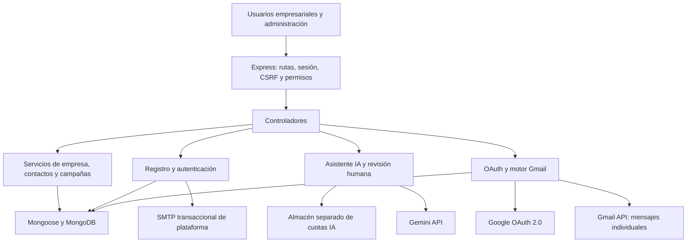
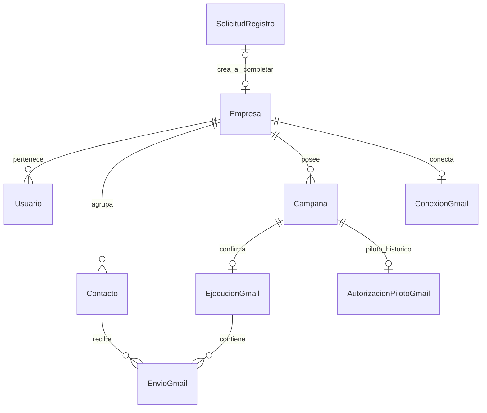
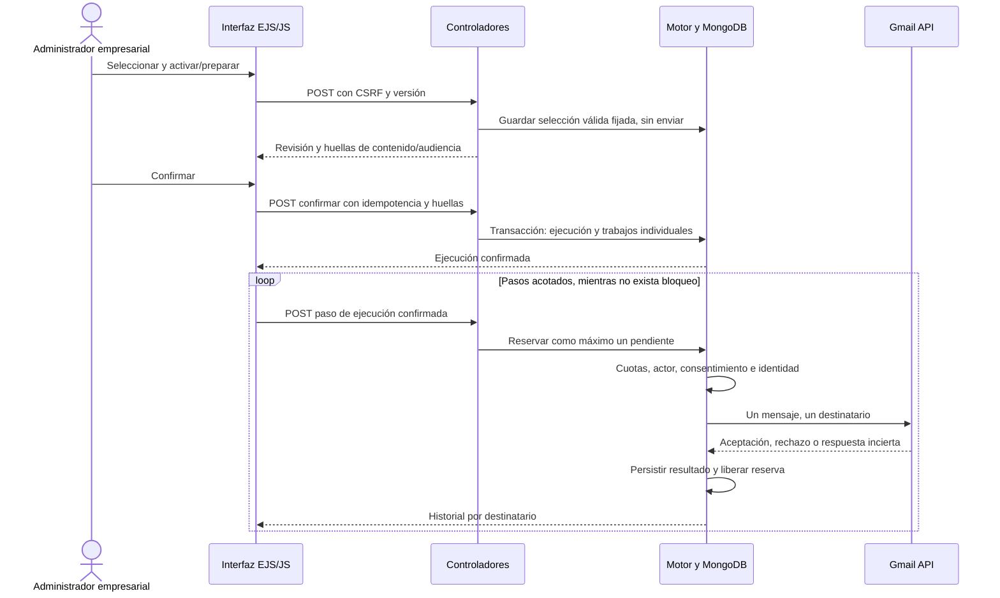

# Documento de Arquitectura y Diseño de Software (SDD) - MVP Implementado de PluriOne

**Proyecto:** Plataforma Inteligente de Marketing Automation 
**Empresa:** PluriOne S.A. de C.V. — Develop Talent & Technology 
**Institución:** TESCI, Ingeniería en Sistemas Computacionales 
**Autora y responsable académica:** Debanie Jocabed Montoya Zúñiga 
**Edición:** 1.0 documental, 19 de octubre de 2026 
**Base funcional:** `78c743424b84cf7ea6d7fc63d2cbf58205727c88`.

Documento descriptivo del sistema implementado. No representa aprobación empresarial ni certificación de seguridad. Se conserva el nombre de archivo por compatibilidad documental.

## Índice

1. Estilo arquitectónico
2. Componentes
3. Modelo de datos
4. Flujo supervisado
5. Seguridad y consistencia
6. Modos de procesamiento
7. Infraestructura y despliegue
8. Decisiones y límites
9. Evidencia y referencias

## 1. Estilo arquitectónico

Aplicación web monolítica modular con renderizado en servidor. Express organiza rutas y middleware; controladores coordinan servicios; Mongoose representa entidades persistidas en MongoDB; EJS y JavaScript presentan formularios y estados. Las integraciones externas están separadas de la lógica empresarial. No existen servicios FastAPI, frontend React ni una arquitectura de microservicios acreditada.

n8n no aparece como transporte porque el motor directo no lo invoca. Sus contratos históricos se conservan, bloqueados, para trazabilidad.

## 2. Componentes

| Componente | Ruta | Responsabilidad |
|---|---|---|
| Construcción y arranque web | `appFactory.js`, `app.js`, `server.js` | Middleware, montaje de rutas, conexión y validaciones de arranque. |
| Acceso y roles | `middlewares/autenticacion.js`, `services/permisos.js`, `services/accesoEmpresaService.js` | Identidad persistida, permisos y pertenencia. |
| Registro empresarial | `controllers/registroPublicoController.js`, `services/autoservicioEmpresarialService.js` | Solicitud, verificación, idempotencia y administrador posterior. |
| Correo de plataforma | `services/smtpTransaccionalService.js`, `services/correoTransaccionalService.js` | Verificación empresarial mediante Nodemailer/SMTP; cuenta independiente de campañas. |
| Contactos | `services/consentimientoContactoService.js`, `services/elegibilidadEmailService.js` | Registro/revocación de consentimiento y elegibilidad. |
| Preparación y revisión | `controllers/revisionEnvioCampanaController.js`, `services/revisionEnvioCampanaService.js` | Selección fijada, exclusiones, huella de audiencia y bloqueos. |
| OAuth empresarial | `services/gmailOAuthService.js`, `services/googleOAuthClienteService.js` | Intercambio y renovación controlados; identidad y scopes. |
| Ejecución | `services/motorEnviosGmailService.js`, `services/gmailMimeService.js`, `services/gmailApiTransporteService.js` | Persistencia, reserva, revalidación, MIME y POST Gmail API. |
| Supervisión en primer plano | `services/envioSupervisadoService.js`, `public/js/envioCampanaManual.js` | Validación de infraestructura sin consumidor y pasos acotados tras confirmación. |
| Automatización opcional | `services/trabajadorCampanasService.js` | Ciclos de pendientes del modo automático, solo bajo habilitación expresa. |
| Asistente IA | `services/iaService.js`, `services/ia/geminiProveedor.js`, `services/ia/limitesIA.js` | Privacidad, llamada Gemini, cuotas, validación de respuesta y aprobación. |
| Presentación | `views/`, `public/css/`, `public/js/` | Interfaz adaptable y estados individuales escapados, sin credenciales. |

## 3. Modelo de datos

Relaciones lógicas según campos e índices; el diagrama no representa claves foráneas SQL ni garantiza por sí mismo integridad referencial.

| Entidad/modelo | Datos y controles relevantes |
|---|---|
| `Empresa`, `Usuario` | Estado empresarial, verificación, rol, asociación y estado de acceso. |
| `SolicitudRegistro` | Estados `pendiente_correo`, `correo_verificado`, `completada`; hashes de enlaces y sesiones; caducidad y control de entrega. |
| `Contacto` | Empresa, canales, actividad, etiquetas y evidencia/historial de consentimiento ligado al email. |
| `Campana` | Asunto, cuerpo, origen asistido, selección fijada, estado y preparación/modalidad. |
| `ConexionGmail`, `EstadoOAuth` | Identidad y scopes, credenciales cifradas, state y metadatos OAuth; no se exportan sus valores. |
| `EjecucionGmail` | Empresa, campaña, actor, huella de contenido y modo. Índices únicos por empresa/campaña y empresa/clave de idempotencia. |
| `EnvioGmail` | Contacto, hash de email/consentimiento, estado, reserva e historial; unicidad por ejecución/email y por referencia Gmail dentro de empresa. |
| `ControlEnvioGmail` | Contadores y exclusión global/empresarial, velocidad y reservas. |
| Almacenes de cuotas IA | Ventanas y consumos por empresa; backend de desarrollo, piloto local o protegido según entorno. |

## 4. Flujo supervisado

La llamada externa ocurre fuera de la transacción. Una pérdida de respuesta puede dejar una reserva o estado incierto: el motor conserva esa ambigüedad y evita convertirla en un segundo envío. Gmail aceptado no significa recepción, apertura ni venta.

## 5. Seguridad y consistencia

- Las consultas y escrituras vinculan recurso y empresa; los campos del cuerpo HTTP no sustituyen identidad o remitente.
- El registro usa enlaces de un uso y configuración de administrador posterior a la verificación. SMTP transaccional es independiente de OAuth de campañas.
- OAuth aplica state, PKCE, nonce, identidad y scope de envío; la cuenta se revalida antes de la llamada.
- El consentimiento exige evidencia documentada; en modo supervisado se fijan huellas de audiencia y consentimiento y se comprueban nuevamente antes de enviar.
- Índices únicos y transacciones previenen doble ejecución y doble trabajo por destinatario. Reservas y cuotas coordinan competidores; no se promete entrega externa exactamente una vez.
- Se distinguen `pendiente`, `reservado`, `enviando`, `aceptado`, `rechazado`, `cancelado` e `incierto`. El cliente no convierte estos estados en autorizaciones nuevas.
- Bcrypt, cifrado y controles de sesión aportan protección técnica; no sustituyen auditoría externa, gobernanza de secretos o cumplimiento normativo formal.

## 6. Modos de procesamiento

| Modo | Procesamiento | Restricción y evidencia |
|---|---|---|
| Manual/piloto | Despacho explícito de un contacto y autorización histórica temporal. | Límite efectivo 1 y posible consumo por empresa o campaña. Compatibilidad preservada. |
| Supervisado | Una confirmación y pasos individuales desde la página; sin temporizador de servidor. | 1–50 según política, texto e inmediato. GET/recarga no envía ni reanuda; pendientes requieren acción explícita. |
| Automático | Consumidor de `procesarPendientes`, fechas y reservas persistentes. | Implementado y probado con Gmail simulado. `server.js` inicia el trabajador si ambas puertas de habilitación y modo automático están abiertas. No hay evidencia de operación productiva programada. |
| n8n histórico | Servicios heredados con bloqueo antes de la petición externa. | No requerido por Gmail directo, sin workflow exportado ni despliegue validado. |

La separación por `modoMotor` evita que un consumidor automático procese trabajos supervisados. Esta revisión no inicia procesos ni cambia opciones.

## 7. Infraestructura y despliegue

La conexión se configura privadamente mediante `MONGODB_URI`. Las transacciones requieren la topología validada por los servicios y los índices correspondientes. El entorno de pruebas en 27018 y los perfiles locales documentados en otras jornadas no son una arquitectura productiva certificada ni valores universales de instalación.

El backend protegido de cuotas IA es exigido por la selección de almacén en producción; `piloto_local` no es una vía de elusión. El arranque general y los lanzadores de piloto tienen requisitos diferentes de sesiones, manifiestos y topología. No debe confundirse iniciar la aplicación en desarrollo con completar TLS, proxy, credenciales, restauración y monitoreo productivos.

## 8. Decisiones y límites

El renderizado EJS reduce la separación de despliegues y mantiene formularios/control de sesión en el servidor. MongoDB/Mongoose permiten modelar entidades y estados con transacciones e índices. El motor directo Gmail conserva identidad OAuth por empresa y elimina dependencia de un workflow externo para el envío. Gemini redacta contenido; el humano decide destinatarios y confirmación.

La elección tecnológica fue libre y autorizada por la empresa según la responsable. No se atribuye aprobación firmada a estas decisiones. Persisten como evolución: métricas comerciales instrumentadas, adjuntos, evaluación productiva del modo programado, auditoría externa y aceptación formal.

## 9. Evidencia y referencias

[PRD](PRD-borrador-tecnico.md), [trazabilidad](entrega/matriz-trazabilidad.md), [memoria técnica](entrega/memoria-tecnica.md), [manual técnico](entrega/manual-tecnico.md), [QA](entrega/reporte-qa.md), [referencias](entrega/referencias.md) y [autoría](entrega/autoria-ia.md). La validación real y la simulada se clasifican en el [registro de evidencias](entrega/evidencias-validacion.md).
