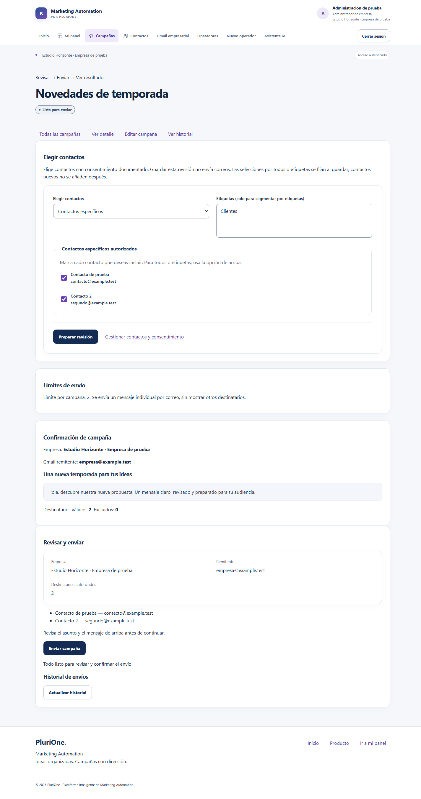
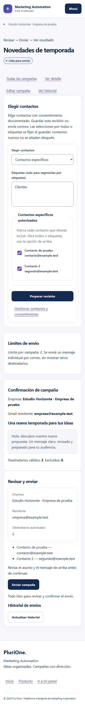
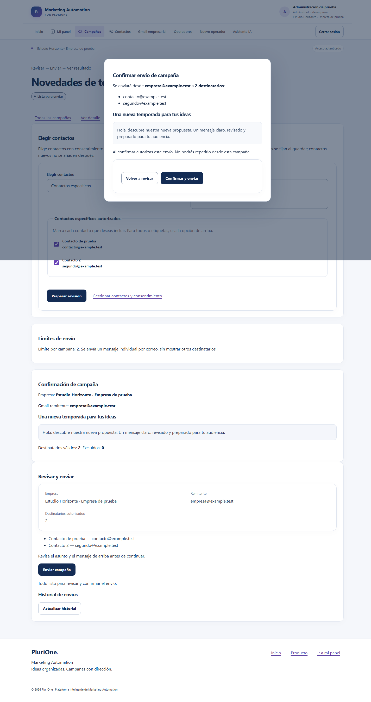
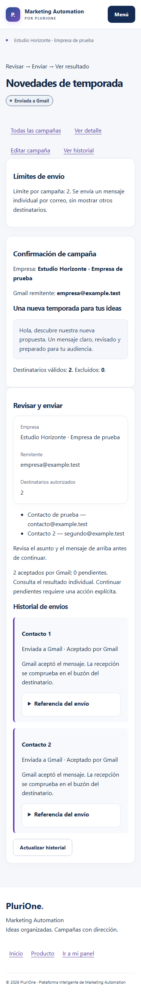

# Manual de usuario - PluriOne

**Proyecto:** Plataforma Inteligente de Marketing Automation 
**Empresa:** PluriOne S.A. de C.V. — Develop Talent & Technology 
**Institución:** TESCI · **Autora:** Debanie Jocabed Montoya Zúñiga 
**Edición:** 1.0 documental, 19 de octubre de 2026 · Base funcional `78c7434`.

## Índice

1. Acceso y roles
2. Registro empresarial
3. Contactos y consentimiento
4. Crear una campaña manual o Gemini
5. Seleccionar, preparar y revisar
6. Confirmar y consultar resultados
7. Modos de envío
8. Resolución de bloqueos
9. Capturas y referencias

## 1. Acceso y roles

Abrir la dirección de la instalación autorizada y entrar desde `/login`. No existe una cuenta ni contraseña universal del proyecto. El administrador de empresa gestiona Gmail y confirma envíos supervisados; el operador prepara recursos de su empresa según permisos; el superadministrador administra la plataforma y no sustituye al administrador empresarial para confirmar ese envío.

Una cuenta pendiente o bloqueada no debe acceder. Si la sesión caduca, entrar nuevamente y revisar el historial antes de continuar cualquier campaña. Cerrar sesión al terminar, especialmente en equipos compartidos.

## 2. Registro empresarial

1. En `/registro`, introducir los datos solicitados de empresa y correo empresarial.
2. Revisar el buzón de esa cuenta y, si procede, spam. El sistema envía el enlace por el correo transaccional de plataforma; no usa todavía el Gmail de campañas de la nueva empresa.
3. Abrir el enlace y confirmar la verificación en la pantalla correspondiente. Un enlace caducado o usado no debe reutilizarse; usar el recorrido de reenvío permitido por la aplicación.
4. Configurar el primer administrador y su contraseña después de verificar el correo.
5. Iniciar sesión y comprobar que el panel corresponde a la empresa registrada.

Si el mensaje no llega, consultar soporte sin compartir el enlace completo, token ni contraseña. No crear repetidamente empresas para eludir el estado pendiente.

## 3. Contactos y consentimiento

Desde Contactos registrar nombre y dirección. Para campañas email se requiere contacto activo, canal email habilitado y consentimiento de marketing documentado: estado vigente, fecha, fuente/evidencia y registro ligado a esa dirección.

Activar el canal no sustituye consentimiento. Al cambiar email debe revisarse su autorización. Un contacto inactivo o revocado queda excluido. Usar etiquetas para segmentar grupos; pertenecer a una etiqueta no concede permiso de marketing.

## 4. Crear una campaña manual o Gemini

**Manual:** abrir Campañas y crear una nueva campaña email de texto con nombre, objetivo, asunto y mensaje. Guardar conserva el borrador; no envía.

**Gemini:** abrir «Crear campaña con IA» o el asistente de `/empresa/ia`; redactar instrucciones sin datos personales, secretos ni contactos y aceptar la confirmación de privacidad. Generar, leer y editar la propuesta. Usar revisión/variante cuando corresponda y aprobar el guardado como borrador. Gemini no elige contactos ni confirma el envío.

En ambos casos continuar hacia la revisión de campaña. Para este motor usar texto: una imagen guardada en el borrador no significa que se enviará adjunta.

## 5. Seleccionar, preparar y revisar

Recorrido actual: **Crear campaña → seleccionar destinatarios → activar y preparar → revisar → confirmar envío → consultar resultados**.

1. Abrir la campaña y su pantalla `/campanas/:id/enviar`.
2. En modo supervisado, elegir contactos específicos mediante casillas, todos los válidos de la empresa o segmentación por etiquetas. Las selecciones por todos/etiquetas se fijan al guardar: no incluyen automáticamente contactos nuevos posteriores.
3. Si está en borrador, pulsar **Activar y preparar envío**. Si ya está activa y es editable en ese recorrido, guardar la preparación/revisión. Esta acción no envía.
4. Revisar cantidad, direcciones, exclusiones, empresa, remitente, asunto y mensaje. La selección está limitada por configuración y se deduplica por dirección.
5. Corregir cualquier requisito indicado. Si falta Gmail, usar la acción **Conectar Gmail** desde la sección Gmail empresarial y autorizar la cuenta correcta. Si faltan destinatarios, volver a **Seleccionar contactos**.

## 6. Confirmar y consultar resultados

Solo cuando la campaña está lista se habilita **Enviar campaña**. Abrir el diálogo, leer el resumen y pulsar **Confirmar y enviar** una vez. Mantener la página abierta durante el envío supervisado; cada mensaje se procesa individualmente con cuotas y velocidad controladas.

Consultar el historial. No crear otra campaña ni cambiar la selección para repetir mensajes cuyo resultado no se conoce.

| Resultado | Significado | Acción recomendada |
|---|---|---|
| Pendiente | Trabajo registrado, aún no aceptado por Gmail. | Revisar cuotas y continuar pendientes solo mediante la acción explícita disponible. |
| Reservado/enviando | Procesamiento en curso o en comprobación. | Actualizar historial y esperar; no repetir confirmación. |
| Aceptado / enviada a Gmail | Gmail aceptó la solicitud y devolvió referencia. | Verificar recepción por separado si se requiere. No reenviar. |
| Rechazado / error | El proveedor rechazó inequívocamente o el envío no pudo completarse. | Revisar motivo y soporte. Los pendientes distintos permanecen registrados. |
| Cancelado | La revalidación o una protección impidió enviar. | Corregir la causa con soporte; no interpretar como permiso automático de reintento. |
| Incierto | No se pudo determinar con seguridad el resultado externo. | Detener el recorrido y solicitar conciliación. No volver a enviar ese trabajo. |

Recargar no envía ni reanuda. El botón de continuar pendientes es una acción consciente sobre una ejecución ya confirmada; no debe usarse ante incertidumbre sin resolver. La aplicación no informa aperturas, clics o conversiones acreditadas a partir del estado aceptado.

## 7. Modos de envío

| Modo | Uso y límite |
|---|---|
| Manual/piloto histórico | Un destinatario, con política y autorización histórica; puede estar consumido. Cambiar solo el máximo no lo convierte en múltiple. |
| Supervisado | Selección múltiple revisada; texto e inmediato; sin trabajador automático. El administrador conserva control del recorrido. |
| Automático/programado | Funcionalidad implementada con consumidor y fechas, probada con proveedor simulado. Su operación productiva no está acreditada. No cambiar una campaña programada a inmediata desde esta pantalla ni activar trabajadores para resolver un bloqueo. |

La elección de modo es una configuración de operación, no una forma de eludir cuotas o historial. Solo personal autorizado debe cambiarla.

## 8. Resolución de bloqueos

| Mensaje o condición | Qué revisar |
|---|---|
| Campaña en borrador o sin preparar | Elegir contactos y activar/preparar; no basta con rellenar contenido. |
| Gmail desconectado, identidad o permiso inválido | Conectar la cuenta empresarial autorizada y revisar el permiso solicitado. |
| Sin contactos elegibles | Actividad, email, canal y evidencia de consentimiento; nunca inventar consentimiento para habilitar el botón. |
| Selección supera límite | Reducir selección o solicitar revisión de política; no dividir campañas para eludir cuotas. |
| Piloto consumido | Consultar historial y solicitar revisión del modo de operación. No borrar el control previo. |
| Destinatarios o consentimiento cambiaron | Recargar revisión y volver a comprobar direcciones antes de confirmar. |
| Cuota o velocidad | Esperar el periodo indicado. Los pendientes se conservan. |
| Infraestructura no validada | Solicitar revisión técnica de índices, topología y arranque; no cambiar a modo automático. |
| Resultado incierto | Conciliar con soporte; no repetir el envío. |

## 9. Capturas y referencias

Las figuras siguientes proceden de una ejecución auténtica de la interfaz de la base funcional con datos sintéticos y Gmail simulado. No prueban recepción real de correos.

Figura 1. Selección mediante casillas y revisión en escritorio (1440 px).

Figura 2. El mismo recorrido en móvil (390 px).

Figura 3. Diálogo de confirmación de dos destinatarios sintéticos.

Figura 4. Historial individual con referencias simuladas; no es evidencia de entrega externa.

[Evidencias y procedencia](evidencias-validacion.md), [manual técnico](manual-tecnico.md), [material de capacitación](capacitacion.md), [autoría](autoria-ia.md).
